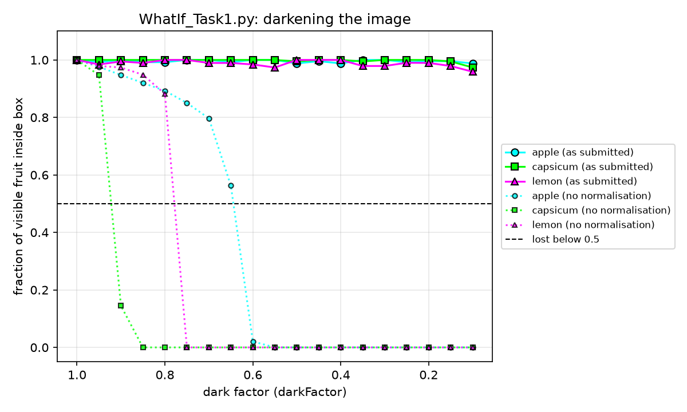

# What-if analysis, Task 1: Darkening

> Ready to paste into the report (one page, Arial 11). Replace the `[ ]` parts in Step 1 with what each member **really** said in the team meeting, *before* anyone ran the code. Wrong predictions cost nothing, but every member needs a prediction **and a reason**; an empty reason ("it will get worse") drops the mark to 1.
> Numbers below are from the course's `Fruits.jpg` (1024 × 783 pixels).

**Set-up.** `Task1.py` as submitted (same colour rules, filter and settings; nothing retuned). The image was darkened from darkFactor = 1.0 to 0.1 in steps of 0.05 (19 values), not mirrored (mirroring changes no colour; the result is the same with mirroring). The boxes found at 1.0 were checked by eye and used as "what is visible" of each fruit. A fruit is **lost** when it has no box or its box covers less than half of that reference box.

### Step 1 — Predict (before running)

| Member | (1) Lost first | (2) At dark factor | (3) Lost last / found at 0.1 | Reason |
|---|---|---|---|---|
| [Name A] | [e.g. capsicum] | [e.g. 0.45] | [e.g. lemon] | [e.g. "the capsicum's brightness threshold is the highest (0.90), so it fails first"] |
| [Name B] | [ ] | [ ] | [ ] | [ ] |
| [Name C] | [ ] | [ ] | [ ] | [ ] |
| [Name D] | [ ] | [ ] | [ ] | [ ] |

### Step 2 — Run: `WhatIf_Task1.py`

**Result: no fruit is ever lost.** At every dark factor from 1.0 to 0.1 all three boxes cover at least 96 % of the reference box (lowest values, at 0.1: apple 0.99, capsicum 0.97, lemon 0.96) and no box grows by more than 1 % (full table: `WhatIf_Task1_output.txt`). So (1) none is lost first, (2) no dark factor, (3) all three are still found at 0.1 ("never lost").

*Figure 1 (WhatIf_Task1.py): fraction of the visible fruit inside the box against dark factor. Solid: Task1.py as submitted, all three stay at ≈1. Dotted: the same code with the brightness normalisation switched off, run only to explain the result. Dashed line: lost below 0.5.*

### Step 3 — Explain

Darkening multiplies R, G and B of every pixel by the same factor k. Our method thresholds **hue** and **saturation**, which are ratios of channel differences, e.g. S = (max − min)/max and H = 60·(G − B)/(max − min) for a red-dominant pixel: the factor k cancels, so they do not change. The third threshold, on **value** V = max(R,G,B), *does* scale with k, but `normalise_brightness` divides the image by its brightest pixel (≈255·k), which cancels k again. The only thing darkening really destroys is precision: at k = 0.1 the brightest pixel is 26, so a fruit pixel has only about 20 grey levels per channel and its hue moves in steps of ≈3°. Our hue ranges are 24–46° wide and sit in gaps between fruit and background, so a few degrees of noise move only edge pixels across a limit; the 15×15 majority filter and the largest-blob step remove those, and the blob area at 0.1 stays within 3 % of its value at 1.0 (apple 17209 → 17435, capsicum 17418 → 17022, lemon 12924 → 12961 pixels). This is why the result is "never lost".

The dotted lines confirm the mechanism: without the normalisation the fruits are lost in the order capsicum (0.90), lemon (0.75), apple (0.60) — exactly their `val_min` thresholds (0.90, 0.75, 0.60). A fruit is lost as soon as k pushes its bright pixels under its brightness limit; hue and saturation never cause the loss.

**Why the wrong predictions were wrong.** [Keep only the lines that match your team's predictions.]
- *"The capsicum (or apple) goes first because red/orange gets dark first"* or *"the lemon lasts longest because it is the brightest"*: this is right for a method that uses absolute brightness — it is exactly the dotted-line order — but our thresholds are relative, so brightness differences between fruits do not matter.
- *"All are lost around 0.5 / below 0.6 because the code was only tuned for 0.6–1.0"*: tuning range is not the limit; the colour features do not change with k at all, so any k that keeps enough 8-bit levels works.
- *"Lost at 0.1–0.2 because of rounding"*: rounding does add hue noise, but at 0.1 the fruits are still the brightest objects (20–26 levels) and the noise is smaller than the width of the hue gaps; dark background pixels become noisy but fail the brightness threshold or are removed by the filter.
