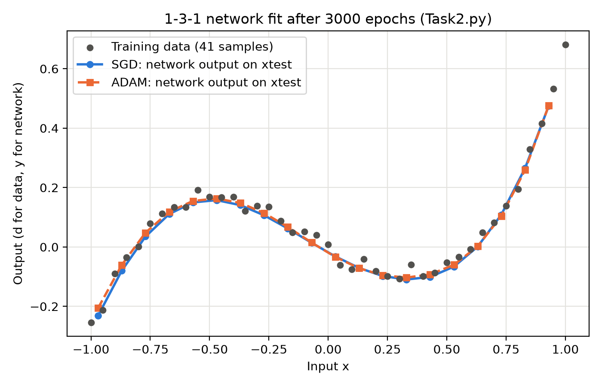
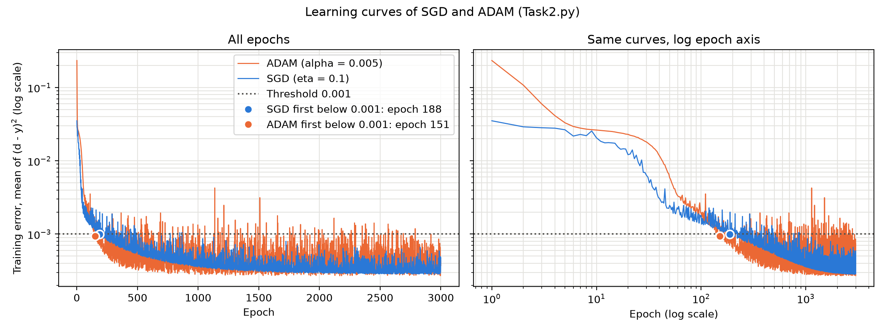

# Task 2: code documentation and viva guide

**What this covers:** the 1-3-1 MLP trained from scratch with SGD and ADAM (`Task2.py`) and the forgotten-derivative What-if (`WhatIf_Task2.py`).

**How to read it:** keep `Task2.py` open next to this document. Section 5 follows the code's `# %%` sections in the same order, so you can read both side by side.

---

## How to use this document

The brief says every member must understand the code of Task 2, whoever wrote it. At the viva the assessor runs `Task2.py`, then each of us answers **one question** about a line, block, variable or function, or about the method behind it. No AI or notes are allowed. Each question is scored 2, 1 or 0. To score 2, the answer has to be **correct without a hint and specific to this code**:

| You are asked about... | A 2-mark answer says... |
|---|---|
| a variable | what it holds (and its shape), **and** where it is used |
| a function | what goes in, **and** what comes out |
| a line or a block | what it computes, **and** what uses the result |
| a "why" or "how" | a reason that fits *this* code and *its* results |

A vague answer that "would be true of any code" ("it trains the network") scores 1.

Every walkthrough section ends with a **Viva check** list. The answers are in that section's text, and the most likely ones are written out in full in [Section 9](#9-viva-question-bank).

"Eq. (n)" always means equation n of the derivation. The equations are listed in [Appendix A](#appendix-a-equation-sheet-and-line-map), and the code comments and `FINALISE.md` use the same numbers.

### Contents

1. [The problem](#1-the-problem)
2. [The network](#2-the-network)
3. [How the program runs](#3-how-the-program-runs)
4. [Shapes cheat-sheet](#4-shapes-cheat-sheet)
5. [Walkthrough of `Task2.py`, section by section](#5-walkthrough-of-task2py-section-by-section)
6. [`WhatIf_Task2.py`](#6-whatif_task2py)
7. [The results, explained](#7-the-results-explained)
8. [What would change if...? (scratch experiments)](#8-what-would-change-if-scratch-experiments)
9. [Viva question bank](#9-viva-question-bank)
10. [Glossary](#10-glossary)
- [Appendix A: Equation sheet and line map](#appendix-a-equation-sheet-and-line-map)

---

## 1. The problem

**The data** (`data/RegressionData.csv`) has 41 samples, with x = −1, −0.95, ..., 0.95, 1 (steps of 0.05). The module team generated the targets as a cubic plus noise:

  d = a·x³ + b·x² + c·x + noise, where the noise is normally distributed with mean 0 and standard deviation 0.02.

We are not told a, b and c. A least-squares cubic, fitted only for this explanation, gives roughly d ≈ 0.94x³ + 0.20x² − 0.47x. The shape is a rise, a fall, then a rise:

```
 d
0.68 ┤                                                    ●   ← x = 1
     │                                                  ●
     │                                                ●
0.2  ┤          ● ● ● ●                             ●
     │      ● ●         ● ●                       ●
0    ┼────●───────────────────●───────────────●──────────── x
     │  ●                       ● ● ● ● ● ● ●
-0.25┤●                                          (sketch, not to scale)
     -1        -0.5          0          0.5          1
```

**The job** has four parts:
1. Build a network y(x) that follows this curve.
2. Train it with backpropagation from the **given** initial weights: first with SGD, then again from the same weights with ADAM.
3. Evaluate it on 20 test inputs `xtest = linspace(-0.97, 0.93, 20)`. These lie *between* the training x values, so they show whether the network learnt a smooth curve or only the 41 points.
4. Report the learning curves, the final training error, and the epoch at which each optimiser first goes below 0.001.

The fixed settings come from the brief, so that all teams' results can be compared:

| Setting | Value |
|---|---|
| SGD learning rate | η = 0.1 |
| ADAM | α = 0.005, β₁ = 0.9, β₂ = 0.999, ε = 1e-8 |
| When the weights are updated | after every sample |
| Shuffling | every epoch |
| Number of epochs | 3000 |
| Random seed | the same value, set at the start of every training run |

---

## 2. The network

### 2.1 Structure and notation

```
           layer (1): hidden, 3 tanh nodes                   layer (2): output, 1 linear node

         ┌─► v1[0] = W1[0,0]·x + b1[0,0] ─tanh─► a1[0] ── W2[0,0] ──┐
         │                                                           │
  x ─────┼─► v1[1] = W1[1,0]·x + b1[1,0] ─tanh─► a1[1] ── W2[0,1] ──┼─► v2 = Σ_j W2[0,j]·a1[j] + b2 ─► y = v2
         │                                                           │
         └─► v1[2] = W1[2,0]·x + b1[2,0] ─tanh─► a1[2] ── W2[0,2] ──┘
```

Each computing node has two halves, an **adder** followed by an **activation function** (Week 2). The adder output is called the *induced local field*, `v`.

| Code | Shape | Lecture symbol | Given initial value | What it is |
|---|---|---|---|---|
| `W1` | (3, 1) | w_1j^(1) | [2, −1.5, 1]ᵀ | weight from input x to hidden node j |
| `b1` | (3, 1) | w_0j^(1) | [1, 0, −1]ᵀ | bias of hidden node j (a weight on a constant input of 1) |
| `W2` | (1, 3) | w_j1^(2) | [0.5, −0.5, 0.5] | weight from hidden node j to the output |
| `b2` | (1, 1) | w_01^(2) | [0] | bias of the output node |
| `v1` | (3, n) | v_j^(1) | – | hidden induced local fields |
| `a1` | (3, n) | x_out,j^(1) | – | hidden outputs, tanh(v1) |
| `v2`, `y` | (1, n) | v^(2), y | – | output field and network output (equal, because the output is linear) |

That makes **10 trainable numbers**: 3 + 3 + 3 + 1.

Python counts from 0 and the lecture counts from 1. So `W1[1, 0]` is w_12^(1) (input to hidden node **2**), and `W2[0, 1]` is w_21^(2) (hidden node **2** to the output).

### 2.2 Why tanh in the hidden layer and linear at the output

- **Hidden layer, tanh.** We need a nonlinearity, or the whole network collapses to a straight line, y = (W2·W1)x + const. tanh is smooth, differentiable everywhere, and its slope is cheap to compute from its output, 1 − a² (Week 2, slide 89).
- **Output, linear.** This is a regression with an unconstrained output (d is both negative and positive). The lecture's rule (Week 2, slide 82) is a linear output node, which "simply sums the nonlinearity created by the hidden layer". It also makes the output delta just the error, Eq. (6).

### 2.3 Intuition: what the three hidden nodes learn

Each hidden node adds one **S-shaped curve** to the output: `W2[0,j] · tanh(W1[j]·x + b1[j])`.
- **Centre** (where the S is steepest): at x = −b1[j] / W1[j].
- **Steepness**: set by |W1[j]|. **Direction** (rising or falling): set by the sign of W1[j].
- **Height**: set by W2[0,j].

The network output is the **sum of three S-curves plus b2**. A cubic has two bends, so three S-curves are enough.

After SGD training (seed 1), the weights are:

| Hidden node | `W1` | `b1` | centre −b1/W1 | `W2` | Role over the data range x ∈ [−1, 1] |
|---|---|---|---|---|---|
| 1 | 1.86 | 2.12 | −1.14 | 1.19 | rising S, centred just left of the data: makes the rise from x = −1 up to the hump |
| 2 | −1.38 | −0.35 | −0.26 | 0.55 | falling S, centred near x = −0.26: makes the fall from the hump to the dip |
| 3 | 2.02 | −2.45 | +1.21 | 1.66 | rising S, centred just right of the data: its lower bend makes the steep rise towards x = 1 |

Then b2 = 0.65 shifts the whole curve vertically.

ADAM ends with **different** weights: centres −1.08, −0.13, +1.13, and steeper slopes. Its curve is almost the same. Many weight sets fit equally well, and which one training finds depends on the path the optimiser takes.

---

## 3. How the program runs

`Task2.py` is a script: it runs from top to bottom once.

```
# %% Settings         import libraries, set paths and constants
        │
# %% Load data        X, D (1×41), the four given weight arrays, xtest (1×20)
        │
# %% Network          define forward() and backward()             ← nothing runs yet
# %% Training error   define training_error() and first_epoch_below()
        │
# %% Train SGD        define train_sgd(), then CALL it  ──► sgd_weights, sgd_errors
# %% Train ADAM       define adam_update(), train_adam(), CALL it ──► adam_weights, adam_errors
        │
# %% Results          print the initial error, final errors, first epochs below 0.001
# %% Plots            Figure 1 (fit) and Figure 2 (learning curves): save PNGs, then show
```

**One training run** is two nested loops. 3000 epochs × 41 samples = **123 000 weight updates**.

```
for epoch in 1 .. 3000:
    order = random permutation of 0..40           ← shuffle every epoch
    for k in order:                               ← 41 updates per epoch
        x, d   = sample k
        a1, y  = forward(x, weights)              ← Eq. (1)–(4)
        grads  = backward(x, d, a1, y, W2)        ← Eq. (5)–(10)
        weights = update(weights, grads)          ← SGD: Eq. (11)    ADAM: Eq. (13)–(16)
    errors[epoch] = training_error(weights)       ← Eq. (12): one point of the learning curve
```

**One update**, for one sample:

```
 sample k ──► forward() ──► a1, y ──► backward() ──► dE/dW1, dE/db1, dE/dW2, dE/db2 ──► update ──► new weights
                                                         (same for SGD and ADAM)     (the ONLY part
                                                                                      that differs)
```

---

## 4. Shapes cheat-sheet

The code stores each sample as a **column**: an input batch has shape (1, n), with one column per sample. This is what lets the same `forward()` work for one sample, all 41 samples, or the 20 test points.

| Variable | Shape | Holds | Created in | Used in |
|---|---|---|---|---|
| `X`, `D` | (1, 41) | all inputs / all targets | Load data | training loops (one column at a time), `training_error`, Plots |
| `xtest` | (1, 20) | the 20 test inputs | Load data | Plots (`forward(xtest, ...)`) |
| `x`, `d` | (1, 1) | one sample | inside the training loops | `forward`, `backward` |
| `W1`, `b1` | (3, 1) | hidden weights and biases | copies of `W1_INIT`, `B1_INIT` | `forward`; updated every sample |
| `W2` | (1, 3) | output weights | copy of `W2_INIT` | `forward`, `backward` (for `delta1`); updated |
| `b2` | (1, 1) | output bias | copy of `B2_INIT` | `forward`; updated |
| `v1`, `a1` | (3, n) | hidden fields / outputs | `forward` | `a1` goes to `backward` |
| `v2`, `y` | (1, n) | output field / output | `forward` | `y` goes to `backward`, `training_error` |
| `e`, `delta2` | (1, 1) | error, output local gradient | `backward` | `dE_dW2`, `dE_db2`, `delta1` |
| `tanh_slope`, `delta1` | (3, 1) | 1 − a1², hidden local gradients | `backward` | `dE_dW1`, `dE_db1` |
| `dE_dW1`, `dE_db1`, `dE_dW2`, `dE_db2` | same as their weight | gradients of E | `backward` | the update lines |
| `m_W1`, `v_W1`, ... | same as their weight | ADAM running averages | `train_adam` | `adam_update` |
| `t` | integer | number of ADAM updates so far | `train_adam` | `adam_update` (bias correction) |
| `order` | (41,) | shuffled sample indices 0..40 | `rng.permutation(N)` | the inner loop |
| `errors` | (3000,) | the learning curve | training functions | Results, Plots |

The two matrix-shape rules that matter:
- `(3,1) @ (1,n) → (3,n)` and `(1,3) @ (3,n) → (1,n)`. The inner sizes must match.
- **Broadcasting.** `W1 @ x + b1` adds the (3, 1) column `b1` to *every* column of the (3, n) result. That is "the same biases for every sample".

---

## 5. Walkthrough of `Task2.py`, section by section

### 5.1 Header: the code map

```python
# CODE MAP of Task2.py
# Settings        libraries, file paths, SGD and ADAM constants, number of epochs, random seed, 0.001 threshold
# ...
# AI use          Claude Opus 5.5 (claude-opus-5-5), High
```

The brief requires a **code map** at the top of every file:
- It is a set of comment lines naming each section and saying what it does.
- The names are the same as the `# %%` section headings, not line numbers, so the map stays correct when the code changes.
- The last line names the AI model used, with its version and setting.

The assessor uses the map to find their way around the file during the viva.

The rest of the header is a **notation key**. It maps each code name to the lecture symbol (Section 2.1) and says that "Eq. (n)" refers to the derivation.

`# %%` marks a **cell**. In VS Code (or Spyder) you can run one cell at a time. When the file is run normally with `python Task2.py`, the markers are just comments.

---

### 5.2 `# %% Settings`

```python
from pathlib import Path

import matplotlib.pyplot as plt
import numpy as np
import pandas as pd

try:
    HERE = Path(__file__).resolve().parent
except NameError:
    HERE = Path.cwd()
DATA_DIR = HERE / "data"        # RegressionData.csv and InitialWeights.npz
FIG_DIR = HERE / "figures"      # the figures are saved here for the report
```

- **Libraries.** These are only the three the brief allows (NumPy, pandas, Matplotlib), plus `pathlib`, which is part of Python itself and only handles file paths. Nothing here does any neural-network work for us.
- **`HERE`** is the folder that contains `Task2.py`.
  - `__file__` is the path of the running script; `.resolve().parent` turns it into the folder.
  - Because `DATA_DIR` and `FIG_DIR` are built from `HERE`, the script finds its data **from any working directory**. That meets the brief's "relative paths" rule: `python task2/Task2.py` from the repo root works, and so does `python Task2.py` from inside `task2/`.
  - The `try/except NameError` is for running cell by cell in an interactive window, where `__file__` does not exist. Then it falls back to the current working directory.

```python
ETA = 0.1           # SGD learning rate (eta)
ALPHA = 0.005       # ADAM step size (alpha; written eta on the Week 4 ADAM slides)
BETA1 = 0.9         # ADAM decay rate of the gradient average m      (beta_m in the slides)
BETA2 = 0.999       # ADAM decay rate of the squared-gradient average v (beta_v in the slides)
EPS = 1e-8          # ADAM epsilon: keeps the step finite when v_hat is ~0
N_EPOCHS = 3000     # one epoch = every one of the 41 samples presented once
SEED = 1            # the same seed is set at the start of every training run
THRESHOLD = 0.001   # we report the first epoch at which the training error goes below this
```

All the fixed settings are constants written in CAPITALS, the Python convention for "do not change". Each is defined once and used everywhere, so a value can never be different in two places.

| Constant | Used in |
|---|---|
| `ETA` | the four SGD update lines in `train_sgd` |
| `ALPHA`, `BETA1`, `BETA2`, `EPS` | `adam_update` |
| `N_EPOCHS` | the epoch loops, the size of `errors`, the plot x-axis |
| `SEED` | `np.random.default_rng(SEED)` at the start of each training function |
| `THRESHOLD` | `first_epoch_below`, the prints, the dotted line in Figure 2 |

The brief fixes all of these except `SEED`. It says "set the random seed (the same value)" but not which value; we chose 1, as in the brief's example. Section 7.3 shows how other seeds compare.

**Viva check:** What does `HERE` hold, and why is it not just `"data/"`? What would break if `SEED` were set once at the top of the file instead of inside each training function?

---

### 5.3 `# %% Load data`

```python
data = pd.read_csv(DATA_DIR / "RegressionData.csv")
X = data["x"].to_numpy().reshape(1, -1)     # inputs,          shape (1, 41)
D = data["d"].to_numpy().reshape(1, -1)     # desired outputs, shape (1, 41)
N = X.shape[1]                              # number of training samples = 41
```

- `pd.read_csv` reads the file into a table with columns `x` and `d`.
- `.to_numpy()` gives a 1-D array of 41 numbers. `.reshape(1, -1)` turns it into a **row** of shape (1, 41); the `-1` means "work out this size". Each column is now one sample, which matches the network's column-vector convention.
- `N` is 41. It is used by `rng.permutation(N)`.

```python
init = np.load(DATA_DIR / "InitialWeights.npz")
W1_INIT = init["W1r"]   # (3, 1) input  -> hidden weights
B1_INIT = init["b1r"]   # (3, 1) hidden biases
W2_INIT = init["W2r"]   # (1, 3) hidden -> output weights
B2_INIT = init["b2r"]   # (1, 1) output bias
```

- A `.npz` file is a zip of named NumPy arrays. The given names are `W1r`, `b1r`, `W2r` and `b2r`.
- The `_INIT` arrays are **never changed**. Every training run starts from copies of them (Section 5.8).

```python
xtest = np.linspace(-0.97, 0.93, 20).reshape(1, -1)    # shape (1, 20)
```

- This gives 20 equally spaced values from −0.97 to 0.93, the same call as in the brief.
- They fall **between** the training inputs (−0.97 is between −1 and −0.95). So the plot on `xtest` tests whether the network learnt a smooth function, rather than only memorising the 41 points.

**Viva check:** What is the shape of `X`, and why a row and not a flat array? What is in the `.npz` file? Why are the test inputs not the same as the training inputs?

---

### 5.4 `# %% Network`: `forward()`

```python
def forward(x, W1, b1, W2, b2):
    v1 = W1 @ x + b1    # Eq. (1)
    a1 = np.tanh(v1)    # Eq. (2)
    v2 = W2 @ a1 + b2   # Eq. (3)
    y = v2              # Eq. (4)
    return a1, y
```

**In:** `x` of shape (1, n), plus the four weight arrays. **Out:** `a1` (3, n), the hidden outputs, and `y` (1, n), the network outputs.

| Line | Eq. | What it computes | Shape |
|---|---|---|---|
| `v1 = W1 @ x + b1` | (1) | the adder of each hidden node: v_j^(1) = w_1j^(1)·x + w_0j^(1). With n inputs, `W1 @ x` is (3,1)@(1,n) = (3,n): every hidden node for every input. `b1` is broadcast across the columns. | (3, n) |
| `a1 = np.tanh(v1)` | (2) | the hidden activation, element by element | (3, n) |
| `v2 = W2 @ a1 + b2` | (3) | the output adder: Σ_j w_j1^(2)·a_j + w_01^(2). `@` does the sum over the 3 hidden nodes. | (1, n) |
| `y = v2` | (4) | linear output: φ(v) = v | (1, n) |

**Why `forward()` returns `a1` as well as `y`:** `backward()` needs `a1` twice. It is the input to the output-layer weights (Eq. 7), and it gives the tanh slope 1 − a1² (Eq. 8). Returning it avoids computing tanh again.

**Where `forward()` is used:**
1. In the training loops, one sample at a time (n = 1).
2. In `training_error`, all 41 samples at once (n = 41).
3. In Plots, on `xtest` (n = 20).

It is one function for all three, because of the column convention.

**Viva check:** What goes into `forward()` and what comes out? Which equation is `v2 = W2 @ a1 + b2`? Why is `y = v2` a separate line?

---

### 5.5 `# %% Network`: `backward()`

**In:** one sample's `x` (1,1) and `d` (1,1), the `a1` (3,1) and `y` (1,1) from `forward()`, and the current `W2` (1,3).
**Out:** the four gradients of E = ½(d − y)² with respect to every weight: `dE_dW1` (3,1), `dE_db1` (3,1), `dE_dW2` (1,3) and `dE_db2` (1,1).

The error flows **backwards** through the same connections the signal flowed forwards:

```
FORWARD   x ──[W1,b1]──► v1 ──tanh──► a1 ──[W2,b2]──► v2 = y ──► e = d − y
                                                                    │
BACKWARD                                                            ▼
          dE/dW1 = −δ1·x     δ1 = (W2ᵀ·δ2) ⊙ (1 − a1²)   ◄──W2ᵀ──   δ2 = e · 1
          dE/db1 = −δ1        ▲ error passed back   ▲ slope of tanh  dE/dW2 = −δ2·a1ᵀ
                                                                    dE/db2 = −δ2
```

```python
    e = d - y                               # Eq. (5)
```
The error of the output node, a (1,1) array. Its sign says which way y must move: e < 0 means y is too high.

```python
    phi2_slope = 1.0
    delta2 = e * phi2_slope                 # Eq. (6)
```
This is the **local gradient** of the output node: δ^(2) = e · φ′(v^(2)). The output is linear, so φ′ = 1 and δ^(2) = e. The slope is written out as its own line so that the code matches the lecture's general formula, which has a φ′ for every layer.

```python
    dE_dW2 = -delta2 @ a1.T                 # Eq. (7)
    dE_db2 = -delta2                        # Eq. (7)
```
These are the output-layer gradients: ∂E/∂w_j1^(2) = −δ^(2) · x_out,j^(1).
- `a1.T` is (1,3), so `(1,1) @ (1,3)` gives one gradient per hidden-to-output weight.
- The bias gradient is just −δ^(2), because the bias's "input" is the constant 1.

```python
    tanh_slope = 1 - a1 ** 2                # Eq. (8)
```
This is the slope of tanh at each hidden node. d tanh(v)/dv = 1 − tanh²(v), and tanh(v) is already stored as `a1`. It lies between 0 and 1:
- It equals 1 when the node's output is 0, where tanh is steepest.
- It approaches 0 when the node saturates (a1 ≈ ±1).

**This is the line the What-if analysis changes** (Section 6).

```python
    delta1 = (W2.T @ delta2) * tanh_slope   # Eq. (9)
```
These are the hidden local gradients: δ_j^(1) = δ^(2) · w_j1^(2) · (1 − a_j²).
- `W2.T @ delta2` is (3,1)@(1,1) = (3,1). It is the error **passed back** to each hidden node, weighted by how strongly that node feeds the output.
- In the lecture's general formula this is the sum Σ_k δ_k^(s+1) w_jk^(s+1) over output nodes. With one output node the sum has one term.
- `*` is element-wise: each hidden node's passed-back error is multiplied by its own tanh slope.
- `@` is a matrix product. Don't confuse the two.

```python
    dE_dW1 = -delta1 @ x.T                  # Eq. (10)
    dE_db1 = -delta1                        # Eq. (10)
```
These are the hidden-layer gradients: ∂E/∂w_1j^(1) = −δ_j^(1) · x. For the biases the input is 1.

**Two design points the examiners like:**

1. **Why the gradients have a minus sign, while the lecture writes "+ η δ x":** ∂E/∂w = −δ · x_out. Steepest descent is w_new = w_old − η·∂E/∂w = w_old + η·δ·x_out. That is the same update written two ways (Eq. 11). We return the *gradient* form because ADAM needs ∂E/∂w itself: it averages the gradient and the squared gradient. With the gradient form, one `backward()` serves both optimisers.
2. **Why all gradients are computed before any weight changes:** `delta1` uses `W2`. It must be the **old** `W2`, the one that produced `y`, because the derivation differentiates E at the current weights. `backward()` returns all four gradients first; the update lines come after, in the training loop.

**Checked numerically:**
- The gradients were compared with finite differences, (E(w+h) − E(w−h)) / 2h with h = 10⁻⁶, for all 10 weights.
- The largest difference was 2 × 10⁻¹⁰, so `backward()` is the exact derivative of E.

**Viva check:** What does `delta1` hold, and where is it used? Why is `delta2` just `e`? Why `W2.T`? What is the difference between `*` and `@` in Eq. (9)? Which line is the derivative of tanh? What goes into `backward()`, and what comes out?

---

### 5.6 Worked example: the very first update, with real numbers

These numbers are exactly what the code computes for the **first sample of the first epoch** of `train_sgd()`.

The seed-1 shuffle puts index 24 first. That sample is **x = 0.2, d = −0.081016**. The weights are the given initial values.

**Forward pass**

| Quantity | Calculation | Value |
|---|---|---|
| `v1` | [2·0.2 + 1, −1.5·0.2 + 0, 1·0.2 − 1] | [1.4, −0.3, −0.8] |
| `a1` | tanh(v1) | [0.885352, −0.291313, −0.664037] |
| `y` | 0.5·0.885352 − 0.5·(−0.291313) + 0.5·(−0.664037) + 0 | 0.256314 |

**Backward pass**

| Quantity | Calculation | Value |
|---|---|---|
| `e` = `delta2` | −0.081016 − 0.256314 | −0.337330 (y is too high) |
| `dE_dW2` | −δ2 · a1ᵀ | [0.298655, −0.098268, −0.223999] |
| `dE_db2` | −δ2 | 0.337330 |
| `tanh_slope` | 1 − a1² | [0.216152, 0.915137, 0.559055] |
| `W2.T @ delta2` | [0.5, −0.5, 0.5] · (−0.337330) | [−0.168665, 0.168665, −0.168665] |
| `delta1` | element-wise product of the two rows above | [−0.036457, 0.154351, −0.094293] |
| `dE_dW1` | −δ1 · x (x = 0.2) | [0.007291, −0.030870, 0.018859] |
| `dE_db1` | −δ1 | [0.036457, −0.154351, 0.094293] |

**SGD update** (η = 0.1, w ← w − 0.1·gradient)

| Weight | Before | After |
|---|---|---|
| `W2` | [0.5, −0.5, 0.5] | [0.470134, −0.490173, 0.522400] |
| `b2` | 0 | −0.033733 |
| `W1` | [2, −1.5, 1] | [1.999271, −1.496913, 0.998114] |
| `b1` | [1, 0, −1] | [0.996354, 0.015435, −1.009429] |

What to notice:
- **Every change pushes y down**, because y was too high. `b2` decreases. The weight on node 1, whose output is positive, decreases. The weight on node 3, whose output is negative, increases, so its negative contribution grows.
- **Node 1's hidden weights hardly move.** Its output 0.885 is near saturation, so its tanh slope is only 0.216, which shrinks its `delta1`. This is the slope's job in Eq. (9): a hidden node's weights change in proportion to how sensitive its output is.

**The same first step with ADAM** (t = 1, for `W2`)

| Quantity | Value |
|---|---|
| g = `dE_dW2` | [0.298655, −0.098268, −0.223999] |
| m = 0.1·g | [0.029866, −0.009827, −0.022400] |
| v = 0.001·g² | [0.0000892, 0.0000097, 0.0000502] |
| m̂ = m / (1 − 0.9¹) | g (the correction divides by 0.1) |
| v̂ = v / (1 − 0.999¹) | g² (the correction divides by 0.001) |
| step = α·m̂ / √(v̂ + ε) | ≈ α·g/\|g\| = [0.005, −0.005, −0.005] |
| new `W2` | [0.495, −0.495, 0.505] |

At the first step, **every one of the 10 weights moves by about α = 0.005**, whatever the size of its gradient. Compare SGD, where `W2[0,0]` moved 0.030 but `W1[0]` moved only 0.0007. ADAM's step depends on the gradient's **sign and consistency**, not its size.

Without bias correction, the first step would be α·(0.1g)/√(0.001g²) ≈ 3.16·α ≈ 0.0158. That is the "step becomes very big" problem on the Week 4 "Adam (2)" slide.

---

### 5.7 `# %% Training error`

```python
def training_error(W1, b1, W2, b2):
    _, Y = forward(X, W1, b1, W2, b2)       # all 41 samples at once, Y has shape (1, 41)
    return np.mean((D - Y) ** 2)
```

**In:** the current weights. **Out:** one number, the mean of (d − y)² over all 41 samples (Eq. 12).

- `forward(X, ...)` runs **all 41 samples in one call**, thanks to the column convention. The hidden outputs are not needed here, so they go into `_` ("ignore").
- **There is no ½** here. The brief defines the training error as the plain mean squared error. The ½ belongs only to the per-sample loss E = ½e², where it cancels the 2 that comes from differentiating e².
- It is called **once per epoch, after the last update of the epoch**, as the brief asks ("at the end of each epoch"). It is not a running average of the per-sample errors during the epoch, which would mix 41 different weight states.

```python
def first_epoch_below(errors, threshold):
    below = np.flatnonzero(errors < threshold)      # indices of all epochs below the threshold
    return int(below[0]) + 1 if below.size > 0 else None    # +1: index 0 is epoch 1
```

**In:** a learning curve (3000 numbers) and the threshold. **Out:** the first epoch below the threshold, counted from 1, or `None` if it never gets there.

- `errors < threshold` is a True/False array. `np.flatnonzero` returns the positions of the `True` values.
- `below[0]` is the earliest of those positions. It gets `+ 1` because Python's index 0 is epoch 1.
- `None` is turned into the text "not reached" in Results, as the brief asks.

**Viva check:** What does `training_error` return, and when is it called? Why is there no ½? Why `+ 1` in `first_epoch_below`? What would it print if the error never went below 0.001?

---

### 5.8 `# %% Train SGD`

```python
def train_sgd():
    W1, b1, W2, b2 = W1_INIT.copy(), B1_INIT.copy(), W2_INIT.copy(), B2_INIT.copy()
    rng = np.random.default_rng(SEED)
    errors = np.zeros(N_EPOCHS)

    for epoch in range(N_EPOCHS):
        order = rng.permutation(N)          # shuffle every epoch: a random order of 0..40
        for k in order:
            x = X[:, [k]]                   # one input,          shape (1, 1)
            d = D[:, [k]]                   # its desired output, shape (1, 1)

            a1, y = forward(x, W1, b1, W2, b2)
            dE_dW1, dE_db1, dE_dW2, dE_db2 = backward(x, d, a1, y, W2)

            W2 = W2 - ETA * dE_dW2
            b2 = b2 - ETA * dE_db2
            W1 = W1 - ETA * dE_dW1
            b1 = b1 - ETA * dE_db1

        errors[epoch] = training_error(W1, b1, W2, b2)  # error at the END of this epoch

    return (W1, b1, W2, b2), errors


print("Training with SGD for 3000 epochs (this takes a few seconds) ...", flush=True)
sgd_weights, sgd_errors = train_sgd()
```

**In:** nothing; it uses the constants and the data. **Out:** a tuple of the four trained weight arrays, and the learning curve (an array of 3000 errors).

Line by line:
- **`.copy()`**: the run works on its own copies of the given weights, so `W1_INIT` etc. stay exactly as loaded. The precise reason:
  - The update lines are written `W2 = W2 - ...`, which makes a **new** array. With these lines the `_INIT` arrays would actually survive even without `.copy()` (we checked).
  - The copy is a **safeguard**. If anyone rewrote an update as the in-place `W2 -= ...`, then without the copy it would overwrite `W2_INIT` itself, and ADAM would start from SGD's trained weights instead of the given ones.
- **`rng = np.random.default_rng(SEED)`** creates a fresh random-number generator with seed 1 **at the start of this run**. `train_adam` does the same. So both runs, and the What-if runs, draw **the same sequence of shuffles**. The brief asks for exactly this: "set the random seed (the same value) at the start of every training run, so that a run gives the same result in any file". The only thing that differs between the SGD and ADAM runs is the optimiser.
- **`rng.permutation(N)`** is a random ordering of 0..40, new every epoch ("shuffle every epoch"). Why shuffle? With a fixed order, the updates are correlated: neighbouring x values one after another, and always the same samples just before the error is measured. Section 8 shows what happens without it.
- **`X[:, [k]]`**: the `[k]` in a list keeps the result 2-D, shape (1, 1). `X[:, k]` would give a 1-D array of shape (1,), and the matrix products in `forward` and `backward` would have the wrong shapes.
- **The four update lines** are Eq. (11): w_new = w_old − η·∂E/∂w. Every sample causes an update ("update after every sample"). This is the **sequential**, or stochastic, mode of the Week 3 slides: 41 updates per epoch, 123 000 in total.
- **`errors[epoch] = training_error(...)`** sits *after* the inner loop, so it is measured at the end of each epoch.
- The `print(..., flush=True)` before the call appears immediately, so nobody thinks the program has hung during the few seconds of training.

**Viva check:** What does `train_sgd()` return? What does `order` hold? Why is the seed set inside the function and not at the top? Why `.copy()`? Which equation is `W2 = W2 - ETA * dE_dW2`? How many updates happen in total?

---

### 5.9 `# %% Train ADAM`

#### `adam_update()`: one ADAM step for one weight array

```python
def adam_update(w, grad, m, v, t):
    m = BETA1 * m + (1 - BETA1) * grad          # Eq. (13)
    v = BETA2 * v + (1 - BETA2) * grad ** 2     # Eq. (14)
    m_hat = m / (1 - BETA1 ** t)                # Eq. (15)
    v_hat = v / (1 - BETA2 ** t)                #          so early averages are too small
    # Eq. (16) as on the lecture slide, with eps inside the square root. (...)
    w = w - ALPHA * m_hat / np.sqrt(v_hat + EPS)
    return w, m, v
```

**In:** a weight array `w`, its gradient `grad` for this sample, its running averages `m` and `v` (all the same shape), and the step count `t`. **Out:** the new `w`, `m` and `v`.

What each line does (Week 4, slides 34–39):

| Line | Eq. | Idea |
|---|---|---|
| `m = ...` | (13) | **Momentum.** An exponential moving average of past gradients. Its memory is about 1/(1 − 0.9) = 10 updates. It smooths the direction: if consecutive gradients agree, m grows; if they flip sign, they cancel. |
| `v = ...` | (14) | **RMSProp.** An exponential moving average of past *squared* gradients. Its memory is about 1/(1 − 0.999) = 1000 updates. √v measures the typical size of this weight's gradient. |
| `m_hat`, `v_hat` | (15) | **Bias correction.** m and v start at 0, so early on they are too small. At t = 1, m = 0.1·g, and dividing by 1 − 0.9¹ = 0.1 gives back g. As t grows, 1 − βᵗ → 1 and the correction fades: by t = 100, 1 − 0.9¹⁰⁰ ≈ 1 (Week 4, slide 39). The correction for v fades much more slowly, because β₂ = 0.999: 1 − 0.999ᵗ reaches 0.99 only at t ≈ 4600, about 112 epochs. |
| `w = ...` | (16) | **The step.** m̂ / √v̂ is a *normalised* gradient: direction from m̂, scaled by the gradient's own typical size. The step is therefore about α when gradients are consistent, and smaller when they disagree. |

- **Everything is element-wise.** Each of the 10 weights has its own m and v, so each weight gets **its own effective step size**. That is the "adaptive" in ADAM (Adaptive Moment Estimation).
- **ε inside the square root.** The Week 4 slide writes √(v̂ + ε); the original ADAM paper writes √v̂ + ε. We follow the lecture. With ε = 10⁻⁸ the difference is negligible here: the final error changed by about 10⁻⁷ and the 0.001 epoch did not change.
- **Names.** The `v` here is ADAM's squared-gradient average, not an induced local field. The slides use the letter v for both. In `forward` the fields are `v1` and `v2`.

#### `train_adam()`

```python
    W1, b1, W2, b2 = W1_INIT.copy(), B1_INIT.copy(), W2_INIT.copy(), B2_INIT.copy()

    m_W1, v_W1 = np.zeros_like(W1), np.zeros_like(W1)
    m_b1, v_b1 = np.zeros_like(b1), np.zeros_like(b1)
    m_W2, v_W2 = np.zeros_like(W2), np.zeros_like(W2)
    m_b2, v_b2 = np.zeros_like(b2), np.zeros_like(b2)
    t = 0
    rng = np.random.default_rng(SEED)
    ...
            a1, y = forward(x, W1, b1, W2, b2)
            dE_dW1, dE_db1, dE_dW2, dE_db2 = backward(x, d, a1, y, W2)

            t += 1
            W2, m_W2, v_W2 = adam_update(W2, dE_dW2, m_W2, v_W2, t)
            b2, m_b2, v_b2 = adam_update(b2, dE_db2, m_b2, v_b2, t)
            W1, m_W1, v_W1 = adam_update(W1, dE_dW1, m_W1, v_W1, t)
            b1, m_b1, v_b1 = adam_update(b1, dE_db1, m_b1, v_b1, t)
```

- It has **the same structure as `train_sgd`**: the same copies, the same seed and shuffles, the same `forward()` and `backward()`, and the same end-of-epoch error. Only the update differs. That is deliberate: the comparison between the two optimisers is then fair.
- **"m, v and the step count t start at zero"**, as the brief says. `np.zeros_like(W1)` makes an array of zeros with `W1`'s shape. There are four (m, v) pairs, one for each weight array.
- **`t += 1` comes before the update**, once per sample. So the first update uses t = 1, which is what the bias correction needs (at t = 0 the correction would divide by 0). After the last sample of the last epoch, **t = 3000 × 41 = 123 000**. t counts *updates*, not epochs; Section 8 shows what goes wrong if it counts epochs.

**Viva check:** What do `m_W2` and `v_W2` hold? What is `t` at the end, and why does it go up per sample? What is the bias correction for? Why is ADAM's first step about α for every weight? What goes into `adam_update()`, and what comes out?

---

### 5.10 `# %% Results`

```python
sgd_epoch = first_epoch_below(sgd_errors, THRESHOLD)
adam_epoch = first_epoch_below(adam_errors, THRESHOLD)
initial_error = training_error(W1_INIT, B1_INIT, W2_INIT, B2_INIT)  # before any training
```

- `sgd_epoch` and `adam_epoch` are integers, or `None`. `epoch_text()` turns them into `"epoch 188"` or `"not reached"`.
- `initial_error` (0.516987) is the error of the given weights before any training. It is not required by the brief, but it shows how far training brings the error down: by about three orders of magnitude.
- The printed block is exactly what the brief asks for:
  - the **final training error** of SGD (and of ADAM), i.e. the value after epoch 3000, so `sgd_errors[-1]`;
  - the **first epoch below 0.001** for each optimiser, or "not reached".

```
Training error with the given initial weights : 0.516987
Final training error (mean of (d - y)^2 over the 41 samples, after the last epoch):
  SGD  (eta = 0.1)      : 0.000475  (4.750e-04)
  ADAM (alpha = 0.005)  : 0.000372  (3.725e-04)
First epoch at which the training error goes below 0.001:
  SGD  : epoch 188
  ADAM : epoch 151
```

---

### 5.11 `# %% Plots`

```python
_, y_sgd = forward(xtest, *sgd_weights)
_, y_adam = forward(xtest, *adam_weights)
```

- **`*sgd_weights`** unpacks the tuple `(W1, b1, W2, b2)` into four separate arguments.
- This runs the trained networks on the 20 test inputs, in one call each.

**Figure 1, `figures/Task2_fit.png`** ("plot the network output on xtest with the training data"):



- Grey dots: the 41 training samples. Blue solid line with circles: SGD on `xtest`. Orange dashed line with squares: ADAM on `xtest`.
- The two fits are almost on top of each other, and both follow the rise–fall–rise of the data without chasing individual noisy points.

**Figure 2, `figures/Task2_learning_curves.png`** ("plot both learning curves on one figure"):



- **The error axis is logarithmic.** The error falls from 0.52 to about 0.0003, three orders of magnitude, which a linear axis would squash into the bottom row.
- **Left panel, linear epoch axis:** all 3000 epochs. It answers the assessor's question "do both come down and flatten?": yes.
- **Right panel, log epoch axis:** the same data. It stretches out the first 100 epochs, where SGD and ADAM behave differently (Section 7).
- **Drawing order:** ADAM is drawn first and SGD on top, so ADAM's taller spikes do not hide the SGD curve.
- The dotted line is 0.001. The dots mark the first epoch below it, and the legend states those epochs.

Design choices:
- Each optimiser has one colour in every figure (blue SGD, orange ADAM), and the data are neutral grey.
- Every axis is labelled, and every figure has a legend and a title naming the file. The brief requires each report caption to name the code file.
- `fig.savefig(...)` is called **before** `plt.show()`, so the PNGs are written even if the windows are closed straight away. `plt.show()` comes last and keeps the windows open for the assessor.

**Viva check:** What does `*sgd_weights` do? Why is the error axis logarithmic? Why two panels? Where are the figures saved?

---

## 6. `WhatIf_Task2.py`

The brief's What-if is the "forgotten derivative": in backpropagation, replace the tanh slope 1 − a² in the hidden delta by 1, as if it had been forgotten, then train again with SGD and with ADAM. The brief requires the change to be made **in a separate code file that prints the result**. This is that file.

It is a **standalone copy of `Task2.py`** with these differences:

| Where | Change |
|---|---|
| Code map and header | describes the What-if; adds the section **Runs** |
| `backward(x, d, a1, y, W2, forget_derivative)` | gains one argument. If it is `True`, `tanh_slope = np.ones_like(a1)` (the factor replaced by 1); otherwise the normal `1 - a1 ** 2`. **This is the only change to the maths.** |
| `train_sgd(forget_derivative)`, `train_adam(forget_derivative)` | pass the switch through to `backward()`; otherwise identical |
| `# %% Runs` | the list `RUNS` holds four runs: SGD normal, SGD derivative forgotten, ADAM normal, ADAM derivative forgotten. The loop trains each one from the given weights with the same seed. The results go in the dictionary `results`, keyed by the run's label. |
| `# %% Results` | prints a table: final training error and first epoch below 0.001 for each run, then the ratio forgotten / normal for each optimiser |
| `# %% Plots` | one figure, `figures/WhatIf_Task2.png`, with two panels: the fit on `xtest` (left) and the learning curves (right). Colour = optimiser, solid = normal, dashed = forgotten, and one shared legend underneath. |

Why it is built this way:
- **The normal runs are inside the same file**, so the comparison "how does the final error compare with the normal run?" comes from one reproducible file.
- **The normal rows print exactly the same numbers as `Task2.py`** (SGD 0.000475 at epoch 188, ADAM 0.000372 at epoch 151). That proves the seed rule works: same code, data and seed, so the same result in any file.
- **A switch, rather than a different line**, makes the only difference between "normal" and "forgotten" visible in one `if`.

### 6.1 Results and the agreed explanation

*To be filled in after the team's What-if meeting.* Write down every member's prediction with its reason, run the file, then agree the explanation (see `FINALISE.md`, Section 5). The What-if is marked in the report, not at the viva; the brief says these analyses "are not examined at the viva". The code of this file can still be asked about, like any submitted code.

---

## 7. The results, explained

### 7.1 The learning curves in numbers (seed 1)

| Epoch | SGD error | ADAM error |
|---|---|---|
| 0 (given weights) | 0.517 | 0.517 |
| 1 | 0.0352 | 0.2342 |
| 10 | 0.0206 | 0.0263 |
| 40 | 0.00307 | 0.01168 |
| 100 | 0.00180 | 0.00197 |
| 150 | 0.00141 | 0.00139 |
| 151 | 0.00114 | **0.00093** (first below 0.001) |
| 188 | **0.000996** (first below 0.001) | 0.00082 |
| 300 | 0.00084 | 0.00048 |
| 3000 (final) | 0.000475 | 0.000372 |
| Median of the last 500 epochs | 0.000316 | 0.000400 |

### 7.2 What the curves show, and why

1. **Both come down and flatten** (Figure 2, left). Training works for both optimisers.

2. **The error stops at about 3–5 × 10⁻⁴, not at 0.**
   - The data contain noise with standard deviation 0.02, i.e. variance 0.02² = 4 × 10⁻⁴. No smooth curve can predict random noise.
   - As a benchmark, the *best possible* cubic (least squares, computed only for this check) leaves an error of **3.08 × 10⁻⁴**. The network's typical late error (SGD median 3.16 × 10⁻⁴) is right at that floor.
   - So the network has learnt the underlying curve, and what is left is noise. Pushing much lower would mean fitting the noise, which is overfitting (Week 4).

3. **The curves are jagged** because the weights change after **every single sample**. Each update helps the sample just presented and slightly disturbs the others, so the error over all 41 samples jitters from epoch to epoch. Batch updates would be smooth, but much slower here (Section 8).

4. **ADAM starts slower** (epoch 1: 0.234 against SGD's 0.035).
   - Early on the errors and gradients are big. SGD's step is η × gradient, so it takes big steps.
   - ADAM's step is about α = 0.005 per update whatever the gradient size (Section 5.6), so in the first epoch a weight can move only about 41 × 0.005 ≈ 0.2.

5. **ADAM goes below 0.001 first** (epoch 151 against 188).
   - Later the gradients are small, and SGD's steps shrink with them. ADAM's normalised steps stay near α, so it keeps moving quickly: on the right panel, ADAM's curve falls more steeply between epochs 40 and 150 and overtakes SGD.
   - This is **not luck of the seed.** With seeds 1–4, ADAM first goes below 0.001 at epochs 143–155 and SGD at 184–194 (Section 7.3).
   - The *exact* epoch is affected by the jitter, because both curves hover around 0.001 for a while. After first going below, SGD is back above it for 46 of the next ~210 epochs, and ADAM for 35 of the next ~250.

6. **ADAM is jaggier near the end**, for the same reason as point 5. Its step does not shrink as the gradients shrink, so it keeps jumping around the minimum by up to about α per update. SGD's steps shrink, so it settles more quietly and slightly lower (median 3.2 × 10⁻⁴ against 4.0 × 10⁻⁴).

7. **Do not over-read the final numbers.**
   - At seed 1, ADAM's final error happens to be lower than SGD's, but its typical late error is *higher*.
   - SGD's last epoch landed above its typical level, and ADAM's slightly below.
   - With seed 3, ADAM's final error is 1.2 × 10⁻³: one spike at epoch 3000.
   - The honest summary: both reach the noise floor; SGD ends lower and steadier on average; ADAM gets below 0.001 sooner.

### 7.3 The same training with other seeds (scratch runs; the submission uses seed 1)

| Seed | SGD first < 0.001 | ADAM first < 0.001 | SGD final | ADAM final | SGD median (last 500) | ADAM median (last 500) |
|---|---|---|---|---|---|---|
| 1 | 188 | 151 | 4.75e-4 | 3.73e-4 | 3.16e-4 | 4.00e-4 |
| 2 | 185 | 155 | 3.08e-4 | 3.66e-4 | 3.21e-4 | 4.09e-4 |
| 3 | 194 | 143 | 3.05e-4 | 1.20e-3 | 3.15e-4 | 3.99e-4 |
| 4 | 184 | 149 | 3.46e-4 | 4.21e-4 | 3.17e-4 | 3.96e-4 |

The epoch ordering and the medians are stable across seeds. The final values are not.

---

## 8. What would change if...? (scratch experiments)

The viva may ask "what would change if it were done differently?". The brief lists this among its examples, and these runs give answers backed by numbers.

Each row changes **one thing** in a scratch copy of `Task2.py`. Everything else is as submitted (seed 1). **These runs are not part of the submission.**

| Change | First < 0.001 | Final error | Median (last 500) | What it shows |
|---|---|---|---|---|
| *Submitted: SGD / ADAM* | *188 / 151* | *4.75e-4 / 3.73e-4* | *3.16e-4 / 4.00e-4* | *the baseline* |
| No shuffling, SGD | 973 | 2.85e-4 | 2.92e-4 | Neighbouring samples come one after another, so the updates within an epoch are correlated. Learning is about 5× slower to reach 0.001. Once settled, the curve is smooth, because there is no randomness. |
| No shuffling, ADAM | 156 | 1.06e-2 | 1.08e-2 | Much worse at the end. With a fixed order, the last samples before every error measurement are always the right-hand end of the data. At epoch 3000 the fit is good there (mean residual d − y = +0.004 for x ≥ 0.75) but off on the left (mean residual −0.135 for x < 0). ADAM's α-sized steps let those last samples pull the weights. **Shuffling matters.** |
| SGD η = 0.01 | 1849 | 7.53e-4 | 7.93e-4 | Steps 10× smaller: smooth but slow, still not settled after 3000 epochs |
| SGD η = 0.5 | 85 | 1.03e-3 | 1.56e-3 | Steps 5× bigger: much faster at first, but it jitters well above the noise floor |
| ADAM α = 0.0005 | 1153 | 3.99e-4 | 4.23e-4 | Slower but quieter |
| ADAM α = 0.05 | 83 | 1.13e-3 | 3.14e-3 | Fast at first, then it jumps around the minimum (steps of about α) |
| ADAM without bias correction | 134 | 3.72e-4 | 4.00e-4 | The first steps are about 3.16× bigger (Section 5.6). *Here* that helped (epoch-1 error 0.031 against 0.234), because the given weights start far from a good fit. Bias correction is a safeguard; it matters most where big first steps are harmful. |
| ADAM with `t` counting epochs | 327 | 3.84e-4 | 3.96e-4 | About 2× slower. v̂ is divided by 1 − 0.999^epoch, which stays small for hundreds of epochs although v warmed up long ago (41 updates per epoch). v̂ is too big, so the steps are too small. |
| Batch gradient descent (mean gradient, η = 0.1) | not reached | 1.61e-3 | 1.68e-3 | Only 3000 updates instead of 123 000. This is why the brief has us update after every sample. |
| ε outside the square root (paper form) | 151 | 3.73e-4 | – | Negligible difference from the lecture form |

The trade-off these rows show again and again: **bigger steps learn faster but settle noisier; smaller steps settle quietly but take longer.**

---

## 9. Viva question bank

Answer out loud, without looking. Each answer below is written at the level of detail that scores 2.

### Settings and data
1. **What does `HERE` hold, and where is it used?** The folder that contains `Task2.py`. It is used to build `DATA_DIR` and `FIG_DIR`, so the script finds `data/` and saves `figures/` from any working directory: the relative-paths requirement.
2. **What is the shape of `X`, and why?** (1, 41), with one column per sample. It matches the column-vector convention of the network, so `forward()` works for one sample, (1,1), or for many, (1,n).
3. **What is in `InitialWeights.npz`?** Four named arrays: `W1r` (3,1), `b1r` (3,1), `W2r` (1,3) and `b2r` (1,1). Every training run starts from copies of them.
4. **Why are the test inputs different from the training inputs?** `xtest` lies between the training x values. Plotting there shows whether the network learnt a smooth curve, not just the 41 points (generalisation).

### Forward pass
5. **What goes into `forward()`, and what comes out?** In: x (1,n) and the four weight arrays. Out: `a1` (3,n), the hidden outputs, and `y` (1,n), the network outputs.
6. **Which equation is `v1 = W1 @ x + b1`?** Eq. (1): the adder of each hidden node, v_j^(1) = w_1j^(1)·x + w_0j^(1). `b1` is broadcast across all columns.
7. **Why does `forward()` return `a1`?** `backward()` needs it for the output-layer gradients (Eq. 7) and for the tanh slope 1 − a1² (Eq. 8).
8. **Why is the output node linear?** This is regression with an unconstrained output, d both negative and positive (Week 2, slide 82). It also makes the output delta equal to e (Eq. 6).

### Backward pass and the derivation
9. **What does `delta1` hold, and where is it used?** The local gradients of the 3 hidden nodes, shape (3,1), Eq. (9). It is used immediately for `dE_dW1 = -delta1 @ x.T` and `dE_db1 = -delta1` (Eq. 10).
10. **Why is `delta2` just `e`?** δ^(2) = e · φ′(v^(2)), and for a linear output φ′ = 1 (Eq. 6).
11. **Where is the derivative of tanh, and why that formula?** `tanh_slope = 1 - a1 ** 2`, Eq. (8). d tanh(v)/dv = 1 − tanh²(v), and tanh(v) is already stored as `a1`.
12. **Why `W2.T @ delta2`?** It passes the output error back to each hidden node, weighted by that node's outgoing weight. It is the lecture's Σ_k δ_k w_jk over output nodes, which has one term here.
13. **Why are the gradients negative, when the lecture adds η δ x?** ∂E/∂w = −δ · x_out, so w − η∂E/∂w = w + ηδx_out: the same update. We keep the gradient form because ADAM needs ∂E/∂w.
14. **Why does `backward()` compute all gradients before any update?** `delta1` must use the old `W2`, the one that produced `y`. The derivation differentiates E at the current weights.
15. **How do you know the gradients are right?** A finite-difference check on all 10 weights agreed to 2 × 10⁻¹⁰.
16. **What is the difference between `*` and `@` in Eq. (9)?** `@` is a matrix product: (3,1)@(1,1). `*` is element-wise: each hidden node's back-propagated error times its own slope.

### SGD
17. **What does `train_sgd()` return?** A tuple of the trained `(W1, b1, W2, b2)`, and `errors`: 3000 training errors, one per epoch, the learning curve.
18. **What does `order` hold?** A random permutation of 0..40, new every epoch. It is the order in which the 41 samples are presented.
19. **Why set the seed inside each training function?** So that every run starts the random generator from the same state. SGD, ADAM and the What-if runs then see identical shuffles, and the only difference is the optimiser. A run gives the same result in any file.
20. **Why `.copy()` of the initial weights?** So that training can never change `W1_INIT` etc. With our `W = W - ...` lines a new array is made anyway. But an in-place `W -= ...` without the copy would overwrite the given weights, and ADAM would start from SGD's trained weights.
21. **Why `X[:, [k]]` rather than `X[:, k]`?** `[k]` keeps the shape (1,1). `X[:, k]` gives shape (1,), and the matrix products would break.
22. **How many weight updates are there in one run?** 3000 epochs × 41 samples = 123 000.

### ADAM
23. **What do `m_W2` and `v_W2` hold?** The running averages of `dE_dW2` and of its square, shape (1,3), Eq. (13) and (14). Both start at zero.
24. **What is `t` at the end of training, and why?** 123 000. It counts updates (one per sample), because the bias correction needs the number of averaging steps actually taken.
25. **What is the bias correction for?** m and v start at 0, so early averages are too small. Dividing by 1 − βᵗ corrects this; at t = 1 it gives m̂ = g and v̂ = g² exactly. Without it, the first steps here are about 3.16× too big.
26. **Why does ADAM move every weight by about 0.005 at the first step?** At t = 1, m̂/√v̂ = g/|g| = ±1, so the step is α·(±1), whatever the gradient size.
27. **What makes ADAM "adaptive"?** Each weight has its own m and v, so each gets its own effective step α·m̂/√v̂, scaled by its own gradient history.
28. **Why is ε inside the square root?** That is how the Week 4 slide writes it. The original paper puts it outside. With ε = 10⁻⁸ the difference here is negligible (checked).

### Training error and results
29. **Why is there no ½ in `training_error`?** The brief defines the training error as the mean of (d − y)². The ½ is only in the per-sample loss E, where it cancels the 2 from differentiating.
30. **When is the training error measured?** Once per epoch, after the epoch's last update, on all 41 samples with the current weights.
31. **Why does ADAM go below 0.001 at a different epoch from SGD?** ADAM's steps are about α whatever the gradient size. It is slower at first, when SGD's big gradients mean big steps. Later, when gradients are small and SGD's steps shrink, ADAM is faster. It crosses first at every seed we tried (143–155 against 184–194).
32. **Why is ADAM's curve spikier near the end?** Its normalised step does not shrink as the gradients shrink, so it keeps moving around the minimum. SGD's step = η × gradient does shrink.
33. **Why doesn't the error go to 0?** The noise variance is 4 × 10⁻⁴, and even the best cubic leaves 3.1 × 10⁻⁴. The network is at the noise floor; going lower would be overfitting.
34. **Which optimiser is better here?** Both fit the data equally well. ADAM reaches 0.001 sooner; SGD settles slightly lower and steadier. The final-epoch numbers alone do not decide it, because of the jitter.
35. **Why do SGD and ADAM end with different weights but the same fit?** Many weight sets give almost the same curve, for example S-curves at slightly different centres with different heights. Each optimiser follows a different path and stops at a different one.

### Plots
36. **Why is the error axis logarithmic?** The error falls by three orders of magnitude, from 0.52 to 3 × 10⁻⁴. On a linear axis everything after the first few epochs would be a flat line at the bottom.
37. **What does `*sgd_weights` do?** It unpacks the tuple `(W1, b1, W2, b2)` into four arguments for `forward()`.

---

## 10. Glossary

| Term | Meaning in this code |
|---|---|
| **Sample** | one (x, d) pair; there are 41 |
| **Epoch** | one pass over all 41 samples, in a shuffled order |
| **Sequential / stochastic mode (SGD)** | update the weights after every sample (Week 3). The opposite is **batch** mode: one update per epoch, using all samples. |
| **Induced local field `v`** | output of a node's adder, before the activation |
| **Local gradient δ** | ∂E/∂v times −1 for a node. Output: e·φ′; hidden: the passed-back error × φ′ |
| **Learning rate η / step size α** | scales each update |
| **Momentum (`m`)** | moving average of gradients: smooths the direction |
| **RMSProp (`v`)** | moving average of squared gradients: measures the typical size of each weight's gradient |
| **Bias correction** | dividing m and v by 1 − βᵗ to undo the start-at-zero bias |
| **Saturation** | a tanh node with output near ±1; its slope 1 − a² is near 0 |
| **Noise floor** | the error that remains because the targets contain random noise (about 3–4 × 10⁻⁴ here) |
| **Overfitting** | fitting the noise of the training data; the network then generalises worse (Week 4) |
| **Broadcasting** | NumPy repeating a (3,1) array across the columns of a (3,n) array |
| **Seed** | the starting state of the random generator; the same seed gives the same shuffles |

---

## Appendix A: Equation sheet and line map

The notation is the Week 3 lecture's:
- Layer (1) is the hidden layer and layer (2) the output layer.
- w_ij^(s) is the weight from node i of the previous layer to node j of layer s; w_0j^(s) is the bias.
- v is an induced local field, and x_out a node output (a1 in the code).

| Eq. | Formula | Line in the code |
|---|---|---|
| (1) | v_j^(1) = w_1j^(1)·x + w_0j^(1) | `v1 = W1 @ x + b1` |
| (2) | x_out,j^(1) = tanh(v_j^(1)) | `a1 = np.tanh(v1)` |
| (3) | v^(2) = Σ_j w_j1^(2)·x_out,j^(1) + w_01^(2) | `v2 = W2 @ a1 + b2` |
| (4) | y = v^(2) (linear) | `y = v2` |
| (5) | e = d − y,  E = ½e² | `e = d - y` |
| (6) | δ^(2) = e·φ^(2)′(v^(2)) = e | `delta2 = e * phi2_slope` |
| (7) | ∂E/∂w_j1^(2) = −δ^(2)·x_out,j^(1),  ∂E/∂w_01^(2) = −δ^(2) | `dE_dW2 = -delta2 @ a1.T`, `dE_db2 = -delta2` |
| (8) | φ^(1)′(v_j^(1)) = 1 − (x_out,j^(1))² | `tanh_slope = 1 - a1 ** 2` |
| (9) | δ_j^(1) = δ^(2)·w_j1^(2)·(1 − (x_out,j^(1))²) | `delta1 = (W2.T @ delta2) * tanh_slope` |
| (10) | ∂E/∂w_1j^(1) = −δ_j^(1)·x,  ∂E/∂w_0j^(1) = −δ_j^(1) | `dE_dW1 = -delta1 @ x.T`, `dE_db1 = -delta1` |
| (11) | w_new = w_old − η·∂E/∂w = w_old + η·δ·x_out | `W2 = W2 - ETA * dE_dW2` (and the 3 lines below it) |
| (12) | error = (1/41) Σ_k (d_k − y_k)² | `np.mean((D - Y) ** 2)` |
| (13) | m(t) = β₁m(t−1) + (1 − β₁)g | `m = BETA1 * m + (1 - BETA1) * grad` |
| (14) | v(t) = β₂v(t−1) + (1 − β₂)g² | `v = BETA2 * v + (1 - BETA2) * grad ** 2` |
| (15) | m̂ = m/(1 − β₁ᵗ),  v̂ = v/(1 − β₂ᵗ) | `m_hat = ...`, `v_hat = ...` |
| (16) | w ← w − α·m̂/√(v̂ + ε) | `w = w - ALPHA * m_hat / np.sqrt(v_hat + EPS)` |

The full chain-rule derivations of Eq. (7) and Eq. (9), one weight in each layer plus the general formulas, are in `FINALISE.md`, Section 4. They go in the report's appendix.
